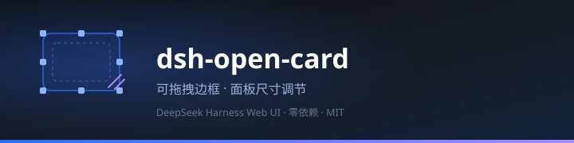
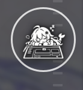
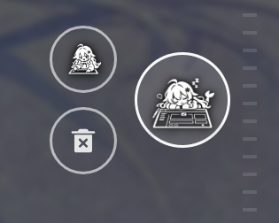
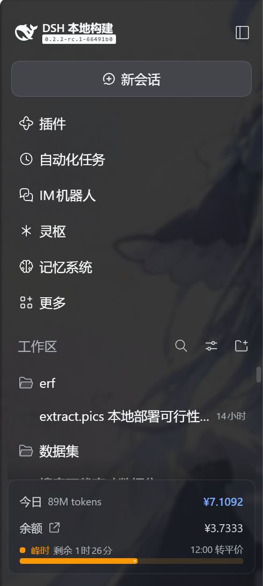
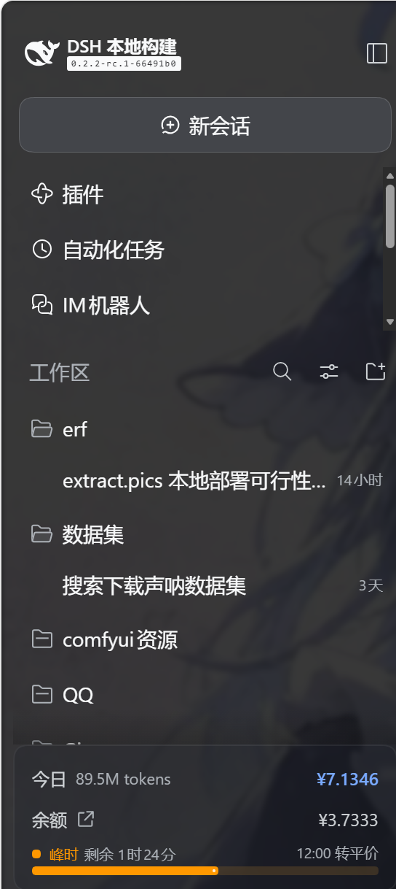

<p align="center">
  
</p>

<h1 align="center">🧩 Drag-to-resize panels for the DeepSeek Harness Web UI (dsh-open-card)</h1>

<p align="center"><strong>Version 1.2.2</strong></p>

<p align="center">
  <em>Pick any panel, drag its borders to resize · sizes remembered · zero dependencies, no framework changes.</em>
</p>

<p align="center">
  <a href="./LICENSE"></a>
  <a href="https://github.com/deepseek-ai"></a>
  <br>
  
  
</p>

<p align="center">
  <a href="README.md">中文</a> | <a href="README.en.md">English</a> | <a href="CHANGELOG.md">Changelog</a>
</p>

## Contents

- [Latest updates](#latest-updates)
- [Preview](#preview)
- [What this is](#what-this-is)
- [The problem it solves](#the-problem-it-solves)
- [Features](#features)
- [Install](#install)
- [Usage](#usage)
- [Storage](#storage)
- [Implementation notes](#implementation-notes)
- [Technical notes](#technical-notes)
- [Icons](#icons)
- [License](#license)

---

## Latest updates

**1.2.2 — three edge-case fixes**

- The edit toolbar was cut off at window edges, putting its last buttons out of reach; resize handles no longer get half clipped when a block touches the screen edge.
- A resized composer reverted after a reload: restore is now resident, writing the size back whenever React rebuilds the node.
- Scroll mode on the sidebar scrolled the whole column instead of the session list inside it; this also fixes panels crushed to zero height and remembered sizes silently expiring after a UI upgrade.
- See [CHANGELOG.md](./CHANGELOG.md) and the [scroll-mode technical note](docs/scroll-mode.en.md).

## Preview

| Collapsed | Expanded |
| --- | --- |
|  |  |

| Full interface | Panels after shrinking |
| --- | --- |
|  |  |

## What this is

`dsh-open-card` is a client-side plugin for the **DeepSeek Harness** Web UI. It puts a draggable frame around *any* panel on the page: click a block, drag its borders to resize it, then move it, raise it, or collapse it entirely. Sizes are stored in the browser and restored on reload.

## The problem it solves

Third-party plugins often fill their own panel with content that covers your conversation list, composer, or toolbar — and you cannot shrink them, because column widths are owned by an internal layout store and plugins expose no API to resize one another.

Instead of guessing at other plugins' DOM structure, this plugin lets **you pick the block**. It snapshots the block's existing inline style, then writes `width` / `height` / `transform` / `z-index` directly. It therefore works on any panel from any plugin, and every change can be undone with one click.

## Features

| Capability | Description |
| --- | --- |
| **Pick a block** | Hovering outlines the block in blue; click to select. `Alt+R` toggles pick mode |
| **Drag to resize** | Eight handles — drag any border or corner; handles slide back into the viewport when a block touches the screen edge |
| **Collapse** | Squash the block to zero height to free the space it covers; the block stays alive and can be expanded again |
| **Scroll mode** | When a block is shrunk, its content keeps its natural size and scrolls internally instead of being squeezed (auto-enabled below 50%); picking a container such as the sidebar hands scrolling to the real session list inside it instead of shifting the whole column |
| **Select parent** | Picking often lands on a tiny inner `span`; jump to the containing container in one click |
| **Move** | Drag the whole block; its offset is remembered too |
| **Raise** | Bring the block to the front so other overlays cannot cover it |
| **Reset / Clear** | Restore one block to how it looked before the plugin touched it, or wipe every record at once |
| **Persistence** | Size, offset, collapsed and scrolling state are persisted per element in `localStorage` and re-applied on reload |
| **Self-minimising launcher** | At rest it is a single circle. One click pops the action buttons out toward the middle of the screen, one at a time; clicking elsewhere or idling for 2.4 s folds them back. The circle is draggable, remembers its position, and is nudged back inside the viewport at the edges |

## Install

```bash
# 1. Put this repository anywhere, e.g.
git clone https://github.com/zenro21/dsh-open-card.git

# 2. Install the package directory through the Harness plugin manager
#    (call plugin_manager in a DSH session, or use "install local bundle" in the plugins page)
plugin_manager({ action: "install_bundle", target: "<absolute-path>/dsh-open-card" })
```

Or install from npm: `dsh plugin --profile web add dsh-open-card`

Reload the page afterwards; a round launcher appears in the bottom-right corner.

> The plugin never reads or writes the Harness source tree and needs no host restart — a page reload loads the new version.

## Usage

1. Click that circle and the action buttons pop out toward the middle of the screen (right when the circle sits on the left half, left when it sits on the right half). Click it again — or click anywhere else — to fold them back.
2. Hover the block you want to resize; when the blue outline appears, click it.
3. Drag any of the eight handles. The floating toolbar offers collapse, scroll, select-parent, reset, raise, move and deselect.
4. `Esc` leaves pick mode or clears the selection. Hold the circle to drag it; its position is remembered.

## Storage

| Key | Contents |
| --- | --- |
| `dsh-open-card.sizes.v1` | Per-element size / offset / collapsed / scrolling state, keyed by a CSS selector anchored on the nearest `id` or `data-slot` |
| `dsh-open-card.dock.v1` | Launcher position |

Upgrading from the previous name `dsh-resizer` reads the old keys, so nothing is lost.

## Implementation notes

`ctx.layout` only exposes navigation and panel selection (`selectPanel` / `toggleSidebar` / `openRightbar` / `closeRightbar`); there is no API for setting column widths, because the three-column widths are owned by the internal `AppFrame` store. This plugin therefore never touches the framework layout — it only affects the specific element you pick.

Also, `shell.overlay` establishes a stacking context at `z-index: 20`, so anything mounted there stays below high-z-index overlays such as floating widgets. The whole UI is mounted on `document.body` through `ReactDOM.createPortal` inside its own layer at `z-index: 2147483000`.

Restore is resident: every remembered block gets a `MutationObserver` filtered to the `style` attribute, so a size is written back whenever React replaces the node or wipes the style — which is why frequently re-rendered, React-owned areas such as the composer keep their size too.

Scroll mode first hands scrolling to the **real scroll region inside the block** (`overflow-y:auto/scroll` and actually scrolling), so picking a sidebar container scrolls the session list rather than shifting the whole column. The investigation, the three stacked causes and the corrections to the original analysis are written up in [docs/scroll-mode.en.md](docs/scroll-mode.en.md).

## Technical notes

| Note | Contents |
| --- | --- |
| [Scroll mode](docs/scroll-mode.en.md) | Why "Scroll" on the sidebar moved the whole column, the fix, verification results, and where the original analysis was wrong · [中文](docs/scroll-mode.md) |

## Icons

Icon artwork by [@zenro21](https://github.com/zenro21); some button glyphs come from [Bootstrap Icons](https://icons.getbootstrap.com/) (MIT).

## License

[MIT](./LICENSE)
