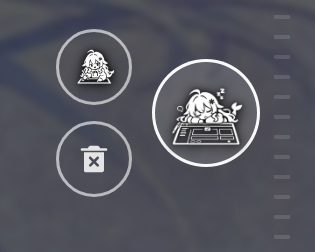
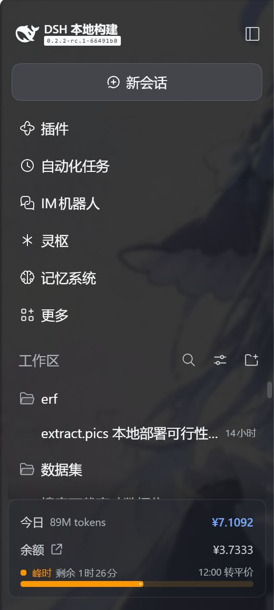
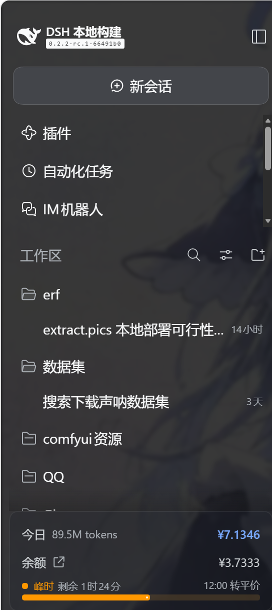

<p align="center">
  
</p>

<h1 align="center">🧩 DeepSeek Harness 面板尺寸调节插件（dsh-open-card）</h1>

<p align="center"><strong>Version 1.2.2</strong></p>

<p align="center">
  <em>点选任意界面块，拖边框改长宽 · 尺寸自动记忆 · 零依赖、不改框架源码。</em>
</p>

<p align="center">
  <a href="./LICENSE"></a>
  <a href="https://github.com/deepseek-ai"></a>
  <br>
  
  
</p>

<p align="center">
  <a href="README.md">中文</a> | <a href="README.en.md">English</a> | <a href="CHANGELOG.md">更新日志</a>
</p>

## 目录

- [更新内容](#更新内容)
- [预览](#预览)
- [这是什么](#这是什么)
- [解决什么问题](#解决什么问题)
- [功能](#功能)
- [安装](#安装)
- [用法](#用法)
- [存储](#存储)
- [实现说明](#实现说明)
- [技术文档](#技术文档)
- [图标](#图标)
- [许可证](#许可证)

---

## 更新内容

**1.2.2 — 三处边缘情况修复**

- 修正编辑工具条在窗口边缘被截断、末尾按钮点不到的问题；缩放手柄贴边时也不再被裁掉一半。
- 修正调好的输入框尺寸刷新后被打回原样的问题：恢复逻辑改为常驻，React 重建节点后自动补写。
- 修正侧栏开「滚动」后滚的是整列、而不是里面的会话列表的问题；顺带修好面板被压成 0 高、界面升级后已记住的尺寸静默失效。
- 详见 [CHANGELOG.md](./CHANGELOG.md) 与[滚动模式技术文档](docs/scroll-mode.md)。

## 预览

| 收起态 | 展开态 |
| --- | --- |
|  |  |

| 整体界面 | 面板收窄后 |
| --- | --- |
|  |  |

## 这是什么

`dsh-open-card` 是 [DeepSeek Harness](https://github.com/deepseek-ai) Web UI 的一个客户端插件。它给页面上**任意**界面块加一层可拖拽的边框：点选之后拉边角改长宽，还能整体平移、置前、收起，尺寸记在浏览器里，刷新后自动恢复。

## 解决什么问题

第三方插件常常在自己的面板里塞满内容，把会话列表、输入区、工具栏挡住，而用户没法把它的尺寸改小——因为布局宽度由框架内部的 store 独占，插件之间也没有互相调整的公开接口。

这个插件不去猜别人的 DOM 结构，也不依赖任何插件的内部实现：**由用户点选目标块**，插件在改动前快照它原有的内联样式，再用内联样式直接写 `width` / `height` / `transform` / `z-index`。所以它对任何插件、任何面板都生效，并且随时可以一键还原。

## 功能

| 你会用到 | 它做什么 |
| --- | --- |
| **点选块** | 鼠标移上去蓝框高亮，点一下选中；`Alt+R` 进入 / 退出点选模式 |
| **拖拽改尺寸** | 8 个方向控制点，任意拖长拖宽；块贴屏幕边时手柄自动收进视口 |
| **收起** | 把块压成 0 高让出位置，块本身还在，随时展开 |
| **滚动模式** | 块缩小后内容保持原大小、改为内部滚动，不被压扁截断（缩到 50% 以下自动开启）；点侧栏这类容器时会把滚动交给里面真正的会话列表，不会整列平移 |
| **上溯一层** | 点选常落在最内层的小 span 上，一键选中包含它的容器 |
| **平移** | 按住整体拖动，位置也一起记住 |
| **置前** | 提到最前，避免被别的浮层盖住 |
| **复位 / 清除** | 这一块还原成插件改动前的样子，或一次清空全部记录 |
| **记忆** | 尺寸、位置、收起 / 滚动状态按元素持久化在 `localStorage`，刷新后自动重建 |
| **自动最小化的悬浮球** | 平时只留一枚大圆；点一下才有功能圆钮从朝屏幕里侧的方向逐颗弹出，点别处或静置 2.4 秒自动收回。圆钮可拖动并记住位置，拖到边缘自动收进视口 |

## 安装

```bash
# 1. 把本仓库放进任意目录，例如
git clone https://github.com/zenro21/dsh-open-card.git

# 2. 用 Harness 的插件管理器安装这个包目录
#    （在 DSH 会话里调用 plugin_manager，或走插件页面的「安装本地包」）
plugin_manager({ action: "install_bundle", target: "<绝对路径>/dsh-open-card" })
```

也可以从 npm 安装：`dsh plugin --profile web add dsh-open-card`

安装后刷新页面即可；右下角会出现一枚圆形悬浮球。

> 插件不读写 Harness 源码树，也不需要重启宿主进程，刷新页面即加载新版本。

## 用法

1. 点右下角那枚圆球，功能圆钮会从朝屏幕里侧的方向弹出来（球在左半边就往右弹，在右半边就往左弹）；再点一下收起，点页面别处也会收起。
2. 鼠标移到要调整的块上，蓝框出现后点一下。
3. 拖 8 个控制点改长宽；顶部工具条给出收起、滚动、上溯、复位、置前、移动、取消。
4. `Esc` 退出点选或取消选中。按住圆球可拖动，位置会被记住。

## 存储

| 键 | 内容 |
| --- | --- |
| `dsh-open-card.sizes.v1` | 每个元素的尺寸 / 位置 / 收起 / 滚动状态，键是元素选择器（锚定最近的 `id` 或 `data-slot`） |
| `dsh-open-card.dock.v1` | 悬浮球位置 |

从旧名 `dsh-resizer` 升级时会自动读取旧键，不丢配置。

## 实现说明

`ctx.layout` 只暴露导航与面板选择（`selectPanel` / `toggleSidebar` / `openRightbar` / `closeRightbar`），没有改列宽的入口——三列宽度由 `AppFrame` 内部 store 独占。因此本插件不触碰框架布局，而是作用于用户选中的具体元素。

同时，`shell.overlay` 自带 `z-index: 20` 的层叠上下文，挂在那里永远压不过鲸鱼挂件一类的高 z-index 浮层；所以整个 UI 用 `ReactDOM.createPortal` 挂到 `document.body`，自己开一层 `z-index: 2147483000`。

恢复逻辑是常驻的：每个记住的块挂一个只看 `style` 属性的 `MutationObserver`，节点被 React 换掉或样式被抹掉就补写回去，因此输入框这类由 React 托管、重渲染频繁的区域也不会复原。

滚动模式会先把滚动交给块内部**真正的滚动区**（`overflow-y:auto/scroll` 且确实在承担滚动的那个），点侧栏容器时滚的是会话列表而不是整列。这一块的排查过程、三个叠加的成因、与原分析文档的出入都记在 [docs/scroll-mode.md](docs/scroll-mode.md)。

## 技术文档

| 文档 | 内容 |
| --- | --- |
| [滚动模式](docs/scroll-mode.md) | 为什么在侧栏开「滚动」会滚整列、修法、验证结果，以及与原分析文档的出入 · [English](docs/scroll-mode.en.md) |

## 图标

图标图片由 [@zenro21](https://github.com/zenro21) 提供；部分按钮图形取自 [Bootstrap Icons](https://icons.getbootstrap.com/)（MIT）。

## 许可证

[MIT](./LICENSE)
